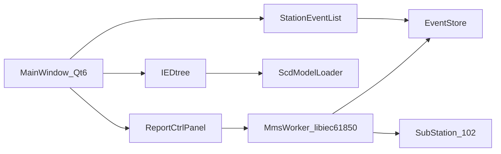

# Qt6 仿真主站（sim_master_qt）

## 目标与边界

- **平台**：仅 **Windows 本机**（MSVC + Qt6 + CMake），不使用 WSL。
- **界面**：对齐参考截图与 [`C:\工程项目开发\client\client\mmsclient`](C:\工程项目开发\client\client\mmsclient) 的 `MainWindow` / `IEDtree` / `reportctrl` 布局（左 SCD 装置树 + 右 Tab + 上数据集表 + 下点值表 + 右下订阅操作）。
- **MMS**：**不**移植参考工程里的 SISCO/MVL 栈（`client.cpp`、`cli_rpt.cpp` 等）；复用 [`免配置/master_sim/third_party/libiec61850`](免配置/master_sim/third_party/libiec61850) 与 [`native/mms_master_cli.c`](免配置/master_sim/native/mms_master_cli.c) 已验证的 RCB/读数据集/文件目录逻辑，改为 Qt 内 **工作线程 + 信号槽**。
- **连接模型（免配置闭环）**：MMS **只连子站** `SubStation`（默认 `192.168.0.10:102`），在合并站模型上按 `ied_name` 浏览各 `E1Q1SBxxLD0` 数据集；**不**按截图对每个 IED IP 单独建链（IP 已在 SCD/台账中，界面 **只读显示**，不提供参考里 IP 编辑/批量赋值按钮）。
- **可省略的按钮/功能**（第一版不做）：`用127.0.0.1`、IP 存文件/从文件读/从 SCD 读/赋给所有 IED、网络抓包、Allied CRC/基本信息、SCD 比对/校验菜单、定值写/切换定值区等需 SISCO 专有服务的操作。

## 工程位置与构建

新建目录 **[`免配置/master_sim/sim_master_qt/`](免配置/master_sim/sim_master_qt/)**：

| 组件 | 说明 |
|------|------|
| `CMakeLists.txt` | `find_package(Qt6 COMPONENTS Widgets Xml)`，`Qt6::Widgets`，C++17，MSVC x64 |
| `build_sim_master.ps1` | 调用 VsDevCmd + CMake **Release** 编译（与 [`build_libiec61850.ps1`](免配置/master_sim/build_libiec61850.ps1) 同模式），链接 `build-win` 的 `iec61850.lib` + `hal.lib` |
| `package_sim_master.ps1` | Release 成功后：`windeployqt` 收集 Qt 运行时 → `cpack -G NSIS` 生成安装包 |
| `installer/` 或 `dist/` | 产物：`SimMasterQt-1.01-win64.exe`（两位小数版本号，与包内一致） |
| `VERSION` | 单行版本源文件，打包脚本 **唯一** 递增入口（见下） |
| `src/main.cpp` | 启动、加载 QSS（可选，参考 `utilty/app_theme` 简化版） |
| `src/ui/*` | 从参考工程 **改写** 的 UI 类（见下） |
| `src/mms/*` | `MmsWorker`：从 `mms_master_cli.c` 抽出 connect/readDataSet/enableRcb/GI/listFiles |
| `src/scd/*` | `ScdModelLoader`：解析 SCD/SMCD + [`out/IEDList.xml`](免配置/master_sim/out/IEDList.xml) |
| `src/event/*` | `EventStore`：线程安全变位队列；`StationEventListWidget`：全站事件 UI |
| `src/util/pinyin_search.*` | 从参考 [`mmsclient/utilty/pinyin_search`](C:\工程项目开发\client\client\mmsclient\utilty\pinyin_search.cpp) 移植多段拼音搜索 |

依赖：本机已安装的 **Qt 6.x**（`CMAKE_PREFIX_PATH` 指向 Qt 安装目录，脚本内可设环境变量 `QT6_DIR`）。

## UI 复刻策略（对照参考源码）

以参考类为 **布局与交互蓝本**，删除对 `client.h` / `mvl_uca.h` 的依赖：

1. **[`iedtree.h/.cpp`](C:\工程项目开发\client\client\mmsclient\iedtree.h)** → `IedTreeWidget`  
   - 搜索框 + `QTreeWidget`：`序号-[ied_name]描述 型号`  
   - 可选保留「报告控制块实例号」节点（跳转 `IedReportInstPanel` 占位页）  
   - 去掉 Allied CRC/基本信息 或保留空页

2. **[`reportctrl.h/.cpp`](C:\工程项目开发\client\client\mmsclient\reportctrl.h)** → `ReportCtrlPanel`（每个 Tab 一个实例，构造时传入 `panelType`）  
   - **上表**：数据集描述、条目数、数据集名、报告控制块名、RptID、ConfRev、订阅状况  
   - **下左表**：描述、地址(FCDA)、前值、后值（变位高亮）  
   - **右下**：订阅 MMS 报告控制块、发起总召唤、实例号、完整性周期、TrgOps/OptFlds 勾选、**全部订阅**  
   - 列宽/分割条比例参考 `reportctrl.cpp` 中 `kReportUpperPaneWeight` 等常量  
   - 订阅状况列显示「本主站已 RptEna」而非 IED 侧 Owner

3. **[`mainwindow.h/.cpp`](C:\工程项目开发\client\client\mmsclient\mainwindow.h)** → `MainWindow`  
   - 顶栏：**只读** 当前 IED 名 + `IP: ch_para`（来自 `IEDList`/`ConnectedAP`），**不**放 IP 编辑与四个 IP 按钮  
   - 工具栏/菜单：**连接 SubStation**、**全站订阅**、**取消全站订阅**（与单 Tab「全部订阅」并存）  
   - 主区 `QSplitter`：左侧 IED 树；右侧 `QTabWidget` 含 **装置详情**（内层 **定值 / 软压板 / 遥信 / 遥测 / 其它 / 装置报告控制块实例 / 录波文件**）+ **全站事件**（独立页，见下）  
   - 菜单精简：`文件→打开SCD…`、退出  
   - 每个 IED 一套 Tab 页缓存（参考 `IedWidgetSet`），切换树节点时切换 stack

4. **全站事件列表** → `StationEventListWidget`（主窗口「全站事件」Tab 或底部 Dock，默认 **Tab** 与装置页同级）  
   - **数据来源**：所有已订阅 RCB 的报告回调中，仅 `reason != NOT_INCLUDED` 且 **值相对上次变化** 的条目写入 `EventStore`（环形缓冲，默认保留最近 1 万条，可配置）。  
   - **列**：时间、装置、报告控制块、数据集成员/描述、61850 地址、前值、后值、变位原因码。  
   - **搜索框**：空格分隔 **多段 AND** 过滤；每段支持中文子串 **或** 拼音首字母（移植 `matchesMultiSegmentSearch`，与参考 IED 树搜索一致）。搜索字段为：`装置名 + 描述 + RCB 名 + 点描述 + 地址` 拼接文本。  
   - **展示模式**（`QComboBox`）：  
     - **平铺列表**：按时间倒序，搜索过滤后显示。  
     - **按装置级**：`QTreeWidget` 一级节点 `ied_name`（可折叠），子节点为该装置变位事件；仅展开/显示匹配搜索的装置。  
     - **按报告控制块级**：一级 `ied_name / rcbName`，子节点为变位明细。  
   - 双击事件行：左侧树选中对应 IED，并切换到该 RCB 所在 Tab/数据集行（联动定位）。

## 全站订阅

- **入口**：工具栏「全站订阅」（需已连接 SubStation）。  
- **范围**：对 SCD 模型中 **全部 IED**，订阅与 **遥信 + 软压板 + 遥测** Tab 规则一致的所有 **BRCB/URCB**（`dsRelayDin/dsAlarm/dsWarning/dsRelayEna/dsAin` 等映射的 RCB；**定值 Tab 的 RCB 默认不订**，避免海量点）。  
- **流程**：  
  1. `ScdModelLoader` 生成全站 `RcbDescriptor` 列表（含 handlerRef、getRef、dsRef、inst、默认 TrgOps/OptFlds，与单装置订阅相同）。  
  2. `MmsWorker::subscribeAll(descriptors)` 队列顺序执行：先 `readDataSet` + `installReportHandler`，再 `setRCBValues`；每完成一条更新进度（`QProgressDialog` 可取消）。  
  3. 失败项写入日志面板，不阻塞其余装置；完成后刷新各 Tab「订阅状况」列与 IED 树订阅标记。  
- **取消**：「取消全站订阅」遍历已启用 handlerRef 调用 `disableRcb`。  
- **与单装置关系**：单 Tab「全部订阅」只作用于当前 IED；全站订阅为全局操作，二者状态共用同一 `MmsWorker` 订阅表。

## 全站变位事件与搜索（拼音）

- 参考实现：[`pinyin_search.cpp`](C:\工程项目开发\client\client\mmsclient\utilty\pinyin_search.cpp) 的 `pinyinInitials` + `matchesMultiSegmentSearch`（GBK 区首字母 + 英文数字段匹配）。  
- **变位判定**：报告项 `reason` 含 `dchg/qchg/GI` 等且 `MmsValue` 与缓存前值不同即记一条事件；带报告时标则显示报告 `timestamp`。  
- **性能**：UI 侧用 `QAbstractTableModel` + 增量 `rowsInserted`；搜索/分组切换时在内存中对 `EventStore` 快照过滤，避免阻塞 MMS 线程。

Tab 与数据集过滤（对齐参考 `get_report_ctrl_info(type, …)` 语义，用 SCL 规则实现）：

| Tab | 典型数据集/RCB（示例） |
|-----|------------------------|
| 软压板 | `dsRelayEna` / `brcbRelayEna` |
| 遥信 | `dsRelayDin`、`dsAlarm`、`dsWarning`、`dsDin*` |
| 遥测 | `dsAin` / `urcbAin` |
| 定值 | `dsSetting`、`dsSetGrpNum`（只读展示，不写 SGCB） |
| 其它 | 通信工况、参数、GOOSE 相关等剩余集 |
| 录波 | 文件目录列表（`IEDList.wave_path`，MMS FileDirectory） |

## SCD / IP 数据（IP 已有）

- **装置列表与描述**：启动时加载 SCD（或已生成的 `station.SMCD`），解析每个 `IED` 的 `name/desc/type` 与 `ConnectedAP` 地址（A 网 IP）。  
- **与台账对齐**：读取 [`master_sim/out/IEDList.xml`](免配置/master_sim/out/IEDList.xml) 的 `no`、`rptno`，用于树节点序号与 RCB 实例号默认值（与 [`ied_list.py`](免配置/master_sim/ied_list.py) / router 的 `$BR$brcbXxx{rptno:02d}` 一致）。  
- **不实现**参考里 `readip_from_file/save_ip` 等交互；IP 冲突时以 IEDList 的 `ch_para` 为准显示。

实现方式：用 **Qt6 Xml** 或 **pugixml**（与 router 一致）做只读解析；**不**移植参考工程 flex/bison 全套 `scdview` 校验链路（体量大且与 sim 主站无关）。

## MMS 业务（libiec61850）

- `MmsWorker` 在 `QThread` 中运行 `IedConnection_tick` 循环（同 `mms_master_cli.c`）。  
- 对外 API（主线程调用，异步结果用 `QMetaObject::invokeMethod` / signal 回 UI）：  
  - `connect(host, port)` / `disconnect`  
  - `readCommState()` → 刷新树节点通断着色（`dsCommState`）  
  - `readDataSet(ref)` → 填充下表  
  - `enableRcb(...)` / `disableRcb` / `triggerGi`  
  - `subscribeAll(QList<RcbDescriptor>)` / `unsubscribeAll()` → 全站订阅  
  - `listFiles(path)` → 录波 Tab  
  - 报告回调 → `reportReceived(ReportEvent)` → `EventStore::append`  
- RCB 引用规则与现有一致：`{ied}LD0/LLN0$BR${name}` + `{rptno:02d}`（见 [`ied_list.py`](免配置/master_sim/ied_list.py)）。

## 与现有 master_sim 关系

- **保留** Python [`gui.py`](免配置/master_sim/gui.py) 运维下装页；Qt 程序为 **独立 exe**（`sim_master_qt.exe`），专门做截图级 MMS 展示。  
- **可选后续**：Python 61850 页改为启动 Qt exe；第一版不强制合并。

## 编译、安装包与安装（交付闭环）

**目标**：功能开发完成后，在 Windows 上 **Release 编译零错误**，产出 **可分发安装包**，并在本机 **完成一次安装** 验证。

### 版本号规则（安装包必含）

- **源文件**：[`sim_master_qt/VERSION`](免配置/master_sim/sim_master_qt/VERSION) 单行，格式 **`主版本.次版本`**，次版本固定 **两位小数**（初值 **`1.00`**）。  
- **递增规则**：每次成功执行 **`package_sim_master.ps1` 并完成安装包生成后**，版本 **+0.01**（脚本内按十进制解析后加 `0.01`，写回时格式化为两位小数）：`1.00` → `1.01` → `1.02` …；写回 `VERSION` 文件。  
- **仅编译不打包**（`build_sim_master.ps1`）**不**自动改版本。  
- **CMake**：将 `VERSION` 注入 `project(SimMasterQt VERSION …)`（映射为 `1.01.0` 供 CPack/Windows 四段号）、`QCoreApplication::applicationVersion()`。  
- **Windows 资源**：`VERSIONINFO` 与 `VERSION` 一致（如 `1.01.0.0`）。  
- **安装包 / 卸载列表**：`SimMasterQt-1.01-win64.exe`；NSIS 与「添加或删除程序」显示 **61850仿真主站 1.01**。  
- **程序内**：**帮助 → 关于** 显示 `61850仿真主站 v1.01`。

### CMake / CPack

在 [`sim_master_qt/CMakeLists.txt`](免配置/master_sim/sim_master_qt/CMakeLists.txt) 末尾配置：

- 从 `VERSION` 读取版本（非写死 `1.0.0`），可执行文件输出名 `sim_master_qt`  
- `install(TARGETS … RUNTIME DESTINATION bin)`  
- `install(DIRECTORY …)` 可选：默认 SCD 样例、`out/IEDList.xml` 模板到 `share/sim_master_qt/`（安装后首次启动可指向该路径）  
- `include(CPack)` + `CPACK_GENERATOR "NSIS"`（需 NSIS 在 PATH，或通过 Qt 安装目录附带工具）  
- `CPACK_PACKAGE_NAME "61850仿真主站"`、`CPACK_PACKAGE_INSTALL_DIRECTORY "SimMasterQt"`  
- 安装包内 **不** 再依赖 `build-win` 源码树；libiec61850 **静态链接**进 exe（与现有 `mms_master_cli` 策略一致），仅需 Qt6 运行时 DLL（由 windeployqt 打入 staging）

### 打包脚本 `package_sim_master.ps1`

1. 读取 `VERSION`（如 `1.00`），**本次安装包使用该版本号**。  
2. 调用 `build_sim_master.ps1 -Configuration Release -DAPP_VERSION=<当前>`（失败则退出，**不**改 `VERSION`）。  
3. `windeployqt` → `cpack -C Release`，输出 `dist/SimMasterQt-<当前>-win64.exe`（如 `SimMasterQt-1.00-win64.exe`）。  
4. **全部成功后**：版本 **+0.01** 写回 `VERSION`（`1.00`→`1.01`），供下一次打包使用。  
5. 打印安装包路径与本次版本号。

（仓库初值 `1.00` 时，**第一次** 成功打包产物为 **v1.00**；第二次为 **v1.01**。）

### 安装验证

- **向导安装**：双击 NSIS 包，默认目录 `%ProgramFiles%\SimMasterQt`，创建开始菜单快捷方式「61850仿真主站」  
- **静默安装（CI/脚本）**：`SimMasterQt-*-win64.exe /S`（NSIS 默认 silent 开关）  
- **验收**：从开始菜单或 `sim_master_qt.exe` 启动，主窗正常；卸载程序列表中出现「61850仿真主站」且可卸载  

## 验收标准

1. Windows 下 `build_sim_master.ps1` 生成 `sim_master_qt.exe`，双击可开主窗。  
2. 打开默认 SCD 后左侧列出装置（与 IEDList 顺序/名称一致），选中装置顶栏显示 **只读 IP**。  
3. 「遥信」Tab 上表出现 `dsAlarm/dsRelayDin` 等；选中行后下表可读当前值；订阅 `brcb*` 后 SCDPro/仿真侧变位，**后值/前值**更新且订阅列显示已订阅。  
4. 「连接 SubStation」成功后 `dsCommState` 刷新树节点通断。  
5. 「录波文件」Tab 能列 `/COMTRADE/`（或台账路径），空目录也算成功。  
6. **全站订阅**：连接后对全站遥信/软压板/遥测类 RCB 批量订阅，进度条完成；仿真变位后各 Tab 与 **全站事件** 均有记录。  
7. **全站事件**：变位行含时间/装置/RCB/点/前后值；搜索 `bh gj`（「保护 告警」首字母等多段）能筛出目标；切换 **装置级 / RCB 级** 树形展示正确。  
8. **编译与安装包**：Release 编译通过；`package_sim_master.ps1` 生成 `dist/SimMasterQt-1.xx-win64.exe`；安装后 exe 属性、卸载列表与 **关于** 版本一致；**连续两次成功打包** 版本递增 **0.01**（如 `1.00`→`1.01`）。

## 实施顺序

1. CMake + 空 MainWindow + 构建脚本跑通  
2. `ScdModelLoader` + `IedTreeWidget` + `pinyin_search`  
3. `ReportCtrlPanel` 静态 UI（无 MMS）  
4. `MmsWorker` + `EventStore` 接入读数据集/订阅/GI/报告回调  
5. **全站订阅** + 各 Tab 过滤 + 录波 Tab  
6. **全站事件列表**（平铺/装置级/RCB 级 + 搜索 + 双击定位）  
7. 联调 26579 免配置环境  
8. **CPack/NSIS + package_sim_master.ps1**：Release 编译、生成安装包、本机安装验证 + README
