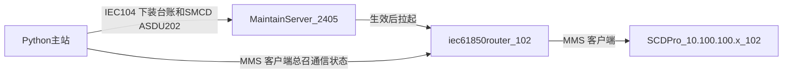

# Windows 仿真主站（运维 + SCDPro + MMS）

> 概述：在 Windows 上用 Python 做免配置仿真主站：从 26579.SCD 生成台账和 SMCD，经装置 2405 运维口下装并生效，由本机 SCDPro 仿真全部保护装置，再由主站 MMS 客户端连接子站 102 端口总召通信状态。

## 待办

| ID | 内容 | 状态 |
|----|------|------|
| gen-config | 从 26579.SCD 生成 IEDList.xml、含 SubStation/dsCommState 的 station.SMCD 和 station.zip | done |
| iec104-master | 实现连接 2405 的 IEC104 主站：下装两个文件并发送 ASDU202 生效 61850 | done |
| network-scdpro | 本机为 10.100.100.x 加地址、装置加路由、安装 unzip，并用 SCDPro 加载 26579.SCD | 进行中（装置路由/unzip 已就绪） |
| mms-client | Windows 编译 libiec61850，Python 连接子站 102 并总招通信状态 | 进行中（端口探测脚本已就绪） |
| e2e | 串起下装、生效、路由进程与 MMS 总招，按验收项核对 | 进行中（下装已成功；102 待 genconfig） |

---

## 目标闭环

本机是主站，也是保护装置仿真机；`192.168.0.10` 是刚部署的免配置子站。

协议依据：`保信子站免配置技术方案_20251120.docx`。报文落地以子站实现为准：`configuration-free/MaintainServer/src/MaintainServer/protocol/yn_maintain103/CMC_yn_maintain103.cpp`。

- 运维口：`192.168.0.10:2405`，IEC 60870-5-104 传输（ini 里的 t0–t3），ASDU 为南网 103。
- 下装：ASDU `0x69` 文件信息、`0x6B` 文件内容；应答 `0x6A` / `0x6C`。文件名含 `IEDList.xml` 时落到 `MaintainServer.ini` 的 `path` + `CONF/`；含 `station.zip` 时落到 `SMCD/` 并 `unzip`。
- 配置生效：ASDU `0xCA`，INF=`2` 表示生效 61850；应答 ASDU `0xCB`，COT=`0x14` 为肯定。生效后子站执行 `iec61850router -d .../CONF/IEDList.xml -c .../SMCD/station.SMCD`。
- 对上 61850：子站监听 102。模型要求 SMCD 里有 IED 名 `SubStation`，且 `LD0/LN0` 下数据集名包含 `dsCommState`（见 `iec61850_router/src/server/config/config_generator.cpp`）。

## 代码放哪里

新建目录 `免配置/master_sim`，纯 Python 3，不改子站仓库业务代码。

- `build_config.py`：读 `免配置/子站scd/26579.SCD`，生成 `out/IEDList.xml`、`out/station.SMCD`、`out/station.zip`。
- `iec104_client.py`：104 链路（STARTDT、I 帧、序号、t1/t3）加上上述 ASDU。
- `mms_client.py`：连 `192.168.0.10:102`，对 `SubStation` 的通信状态数据集做总召并打印。
- `run_lab.py`：按顺序检查网络、下装、生效、MMS 总召。
- `gui.py`：图形界面（生成 / 下装 / 一键流程 / 端口探测）。

## 1. 从 SCD 生成下装文件

SCD 中约 60 个 `ConnectedAP`，IP 为 `10.100.100.x`，MMS 端口 102。

`IEDList.xml` 按技术方案 3.1，只收录这些 61850 装置：

- `p_type=1`，`ch_para=<IP>:102`，`ied_name` 用 SCD 的 `iedName`
- `no` 从 1 递增，顺序与 `dsCommState` 条目一致
- `rptno`、`BRCB_OptFlds`、`URCB_OptFlds`、`BRCB_TrgOps`、`URCB_TrgOps`、`wave_dir=COMTRADE`、`wave_type=7`、`n61850_version=1` 用文档默认值

`station.SMCD`：以 SCD 为 SCL 底稿，插入 IED `SubStation`（AccessPoint / Server / LD0 / LN0 / DataSet 名含 `dsCommState`，FCDA 顺序与 IEDList 中 61850 装置一致）。其余 IED 保留，供子站 `convert2CID` 把各装置 LDevice 并进 `SubStation`。打成 zip，压缩包根目录就是 `station.SMCD`（子站解压到 `SMCD/`）。

装置上先安装 `unzip`。若 `genconfig.jar` 因模型不完整失败，根据 `~/router/router/logs` 补 `SubStation` 的 LN/DO，而不是改子站 C++。

## 2. 运维主站

连接 `192.168.0.10:2405`。ASDU 布局按 `CMsgHandler` 在 `yn_maintain103` 里的取值偏移实现（TYP/VSQ/COT/地址/FUN/INF/RII 及文件体），不另造一套帧格式。

流程：

1. STARTDT 激活。
2. 下装 `/CONF/IEDList.xml`。
3. 下装 `/SMCD/station.zip`。
4. 发 ASDU 202，INF=2。
5. 收到 ASDU 203 且 COT=0x14 后，在装置上确认进程 `iec61850router` 以及 102 端口。

下装前保证 `MaintainServer` 的 PATH 含 `/home/admin/router/bin`，`LD_LIBRARY_PATH` 含 `/home/admin/router/lib`，否则生效后拉起的路由程序找不到库。

## 3. SCDPro 与网段

仿真程序：`C:\工程项目开发\fz\dist\FZ-SCDPro-Win64-1.0.8\scdpro.exe`，加载同一份 `26579.SCD`，仿真模式沿用该目录旁的 `multi_mms_config.ini`（`is_simulation=1`）。

网络（本机网卡已有 `192.168.0.27`，与装置 eth0 互通）：

- 在该网卡上为 SCD 中每个 `10.100.100.x` 增加 IPv4 地址，使 SCDPro 能在装置 IP 上听 102。
- 装置增加路由：`10.100.100.0/24 via 192.168.0.27 dev eth0`。
- 从装置 `ping` 一台 IED IP，并确认本机 102 在听。

地址添加需要管理员权限，单独放 `add_sim_ips.ps1`，由人工提权执行一次。

## 4. 对上 MMS 客户端

用仓库里已有的 `configuration-free/iec61850_router/third_party/libiec61850-1.5.3` 在 Windows 编出 DLL，Python 通过 ctypes 连接子站 102：

- 关联成功
- 找到 `SubStation` 通信状态数据集（名称包含 `dsCommState`）
- 总召并打印各装置通断

主站只连子站这一条 MMS，不直接连 60 台 IED。

## 5. 验收

1. 2405 下装两次均收到肯定应答，装置上 `.../maintain/CONF/IEDList.xml` 与 `.../maintain/SMCD/station.SMCD` 存在。
2. ASDU 203 COT=0x14，`iec61850router` 在跑，102 在听。
3. 装置能访问至少一台 `10.100.100.x:102`（SCDPro）。
4. 本机 MMS 客户端打出通信状态；此时装置尚未与全部 IED 建链时，状态可以为断开，但总召本身必须成功。
