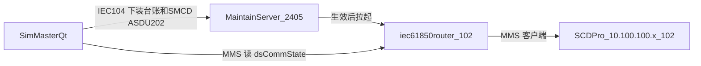

# Windows 仿真主站（运维 + SCDPro + MMS）

> **产品：** SimMasterQt（`免配置/master_sim/sim_master_qt`）。Python 旧 GUI / `run_lab.py` 不再作为闭环验收入口。
>
> 闭环：从 SCD 生成台账和 SMCD，经装置 2405 运维口下装并生效，由本机 SCDPro 仿真保护装置，再由主站 MMS 客户端连接子站 102 读 **`SubStationLD0/LLN0$dsCommState`**。

## 待办

| ID | 内容 | 状态 |
|----|------|------|
| gen-config | 从 SCD 生成 IEDList.xml、含 SubStation/dsCommState 的 station.SMCD 和 station.zip | done（`ConfigGenerator`） |
| iec104-master | 连接 2405：下装两文件并发送 ASDU202 生效 61850 | done（`Iec104MaintainClient`） |
| network-scdpro | 本机为 10.100.100.x 加地址、装置加路由、SCDPro 加载 SCD | 实验室按现场 |
| mms-client | `mms_master_cli` 连接子站 102 并读通信工况 | done（附录 A：MMS 优先，smcd_fcda 后备） |
| e2e | SimMasterQt 一键下装、生效、等 102、工况对照台账 | 进行中（大模型冷启动 8～15 分钟） |

---

## 目标闭环

本机是主站，也是保护装置仿真机；`192.168.0.10` 是免配置子站。

协议依据：`保信子站免配置技术方案_20251120.docx`（主站 61850 工况见 **`保信子站免配置技术方案_20251120_规范版.docx` 附录 A**）。报文落地以子站实现为准：`configuration-free/MaintainServer/src/MaintainServer/protocol/yn_maintain103/CMC_yn_maintain103.cpp`。

- 运维口：`192.168.0.10:2405`，IEC 60870-5-104 传输（ini 里的 t0–t3），ASDU 为南网 103。
- 下装：ASDU `0x69` 文件信息、`0x6B` 文件内容；应答 `0x6A` / `0x6C`。文件名含 `IEDList.xml` 时落到 `MaintainServer.ini` 的 `path` + `CONF/`；含 `station.zip` 时落到 `SMCD/` 并 `unzip`。
- 配置生效：ASDU `0xCA`，INF=`2` 表示生效 61850；应答 ASDU `0xCB`，COT=`0x14` 为肯定。生效后子站执行 `iec61850router -d .../CONF/IEDList.xml -c .../SMCD/station.SMCD`。
- 对上 61850：子站监听 102。模型要求 SMCD 里有 IED 名 `SubStation`，且 `LD0/LN0` 下数据集名包含 `dsCommState`。主站读点为 **`SubStationLD0/LLN0$dsCommState`**（禁止 `LD0/…`，禁止全站扫 `LPHD1.Proxy` 冒充验收）。

## 代码放哪里

产品在 `免配置/master_sim/sim_master_qt`，不改子站仓库业务代码。

| 层 | 模块 |
|----|------|
| 配置 | `src/ops/config_generator.cpp`、`station_zip_writer.cpp` |
| 运维 2405 | `src/ops/iec104_maintain_client.cpp`、`lab_operations.cpp`、`ui/ops_deploy_widget.cpp` |
| 61850 102 | `src/mms/mms_client_bridge.cpp`、`src/mms/comm_state_support.cpp`、`ui/mms_master_widget.cpp`、`native/mms_master_cli.c` |

对照工具（非验收）：`build_config.py`、`iec104_client.py`。

## 1. 从 SCD 生成下装文件

SCD 中 ConnectedAP 的 IP 为装置 `ch_para`，MMS 端口 102。

`IEDList.xml` 按技术方案 3.1，只收录这些 61850 装置：

- `p_type=1`，`ch_para=<IP>:102`，`ied_name` 用 SCD 的 `iedName`
- `no` 从 1 递增，顺序与 `dsCommState` 条目一致
- `rptno`、`BRCB_OptFlds` 等用文档默认值

`station.SMCD`：以 SCD 为 SCL 底稿，插入 IED `SubStation`（AccessPoint / Server / LD0 / LN0 / DataSet 名含 `dsCommState`，FCDA 顺序与 IEDList 中 61850 装置一致）。其余 IED 保留，供子站 `convert2CID` 把各装置 LDevice 并进 `SubStation`。打成 zip，压缩包根目录就是 `station.SMCD`。

## 2. 运维主站

连接 `192.168.0.10:2405`。ASDU 布局按 `CMsgHandler` 在 `yn_maintain103` 里的取值偏移实现。

流程：

1. STARTDT 激活。
2. 下装 `/CONF/IEDList.xml`。
3. 下装 `/SMCD/station.zip`。
4. 发 ASDU 202，INF=2。
5. 收到 ASDU 203 且 COT=0x14 后，确认进程 `iec61850router` 以及 102 端口（大 SMCD **8～15 分钟**）。

## 3. SCDPro 与网段

仿真程序加载同一份 SCD。本机绑定 `10.100.100.x`，装置增加路由 `10.100.100.0/24 via <本机>`。地址添加需要管理员权限，执行 `add_sim_ips.ps1`。

## 4. 对上 MMS 客户端

`mms_master_cli` 连接子站 102：

- 关联成功
- 读 `SubStationLD0/LLN0$dsCommState`
- 优先 `source=directory` 或 `dataset`；全量读失败且连接未断时 `source=smcd_fcda`（FCDA 顺序与下装 SMCD 一致）
- 日志/UI 必须带 `ref` 与 `source`，不得以 Proxy 扫全站冒充通过

主站只连子站这一条 MMS，不直接连各 IED。

## 5. 验收

1. 2405 下装两次均收到肯定应答，装置上 `.../maintain/CONF/IEDList.xml` 与 `.../maintain/SMCD/station.SMCD` 存在。
2. ASDU 203 COT=0x14，`iec61850router -d …IEDList.xml -c …station.SMCD` 在跑，102 在听。
3. 装置能访问至少一台 `10.100.100.x:102`（SCDPro）。
4. SimMasterQt / CLI 读出通信工况；条目数与 FCDA/台账一致；通断值允许为分。
5. `61850_functional_test.py --cli-only`：轻量连通/LD → 工况 → 数据集/RCB，目标 7/7 可重复。
